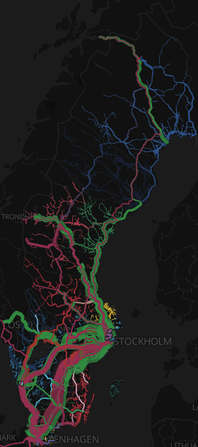

# Swedish transit map

[](README.md)
[](README.sv.md)

An interactive map of Sweden's public transport: every tram, metro, train, bus and ferry line of
21 regional operators plus the long-distance trains, drawn along their real routes, with stops,
timetable-based filters and an all-of-Sweden view. The interface is in English and Swedish, with light and dark themes.

**Live site: <https://transit-karta.lacunasystems.se/>**

<p align="center"></p>

The site is fully static (`site/`). All processing happens ahead of time in Python, using only
the standard library, and a GitHub Action refreshes the data weekly.

## Layout

| Path                         | What it is                                                                                                        |
|------------------------------|-------------------------------------------------------------------------------------------------------------------|
| `site/`                      | The published site: `index.html`, `app.js`, `style.css` and the built data in `site/data/`                        |
| `site/i18n.js`, `site/i18n/` | Interface strings, one file per language (`en.json`, `sv.json`), and language detection                           |
| `update.py`                  | Downloads every feed, refreshes colours and rail geometry, builds all regions (in parallel) and the national view |
| `build.py`                   | Builds one region from GTFS: lines, shared corridors, stops, timetable activity, colours                          |
| `aggregate.py`               | Combines the built regions into the all-of-Sweden view                                                            |
| `stations.py`                | Station name matching and merging of stations that are one place                                                  |
| `geo.py`                     | Distances, simplification, and the curves that join and bend paths                                                |
| `colours.py`                 | Contrast and brand-colour shades                                                                                  |
| `osm.py`                     | OpenStreetMap: line colours and routing trains along the rail network                                             |
| `netex.py`                   | Trafiklab NeTEx: line categories and colours                                                                      |
| `regions.json`               | The regions: feeds, filters, brand and category colours, excluded routes                                          |
| `colors/`                    | Line colours per region from OSM and NeTEx (refreshed by `update.py`)                                             |
| `tests/`                     | Unit and integration tests (a small synthetic GTFS feed) and checks of the built data                             |

## Running locally

```sh
python3 update.py                # download and build everything (about 4 minutes)
python3 update.py vt sl          # just some regions (the national view is rebuilt too)
python3 -m http.server -d site   # then open http://localhost:8000
```

Optional keys, in the environment or a git-ignored `.env`:

- `TRAFIKLAB_GTFS_REGIONAL_KEY`: download GTFS from Trafiklab instead of the keyless Mobility Database mirror.
- `TRAFIKLAB_NETEX_KEY`: needed for `--netex`, which refreshes NeTEx line categories. The free tier allows
  50 calls a month and a full refresh uses 21.

## Languages and themes

The language and theme are chosen in the settings menu (the cog next to the region). Left on
*Automatic*, the language is Swedish when the keyboard layout is Swedish (read from the browser's
keyboard API in Chromium-based browsers, and in others from the first å and ö or ä typed) or the browser prefers
Swedish, and English otherwise. The theme follows the system unless set to light or dark. Both
choices are remembered in the browser.

To add a language, copy `site/i18n/en.json` to `site/i18n/<code>.json`, translate the values (keep
the `{placeholders}`; `one`/`other` entries are plural forms) and add the language to `LANGUAGES`
in `site/i18n.js`. The tests check that every language has the same keys and placeholders.

## Tests

```sh
PYTHONHASHSEED=0 python3 -m unittest discover -s tests -t .
pipx run ruff check .
```

## GitHub Actions

- `tests.yml`: lint and tests on every push and pull request to `master`.
- `update-data.yml`: weekly data refresh, committed back to the repository. On the first Monday of the month it
  also refreshes NeTEx.
- `pages.yml`: tests, then deploys `site/` to GitHub Pages whenever the site or its data changes.
  Enable it once under *Settings → Pages → Source: GitHub Actions*.

## License

The code is released into the public domain under the [Unlicense](LICENSE).

That dedication doesn't extend to third-party material, which keeps its own terms:

- The icons in `site/app.js` and `site/index.html` are from Google's Material Design icons (Apache License 2.0).
- The built data in `site/data/` and `colors/` is derived from the sources below and follows their licences.
  In particular, line colours and rail geometry taken from OpenStreetMap are under the Open Database License
  (ODbL) and need the attribution the map shows.

## Data

Timetables: Samtrafiken / Trafiklab GTFS Regional and NeTEx Regional. Line colours and rail geometry:
© OpenStreetMap contributors. Basemap: OpenFreeMap / OpenMapTiles.
